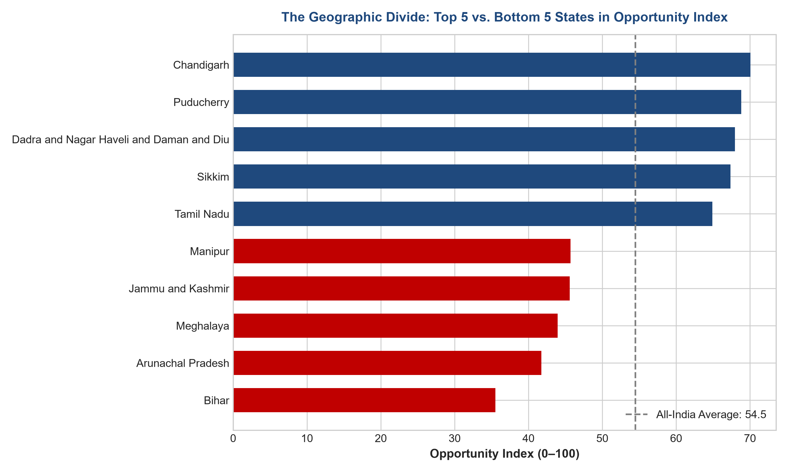
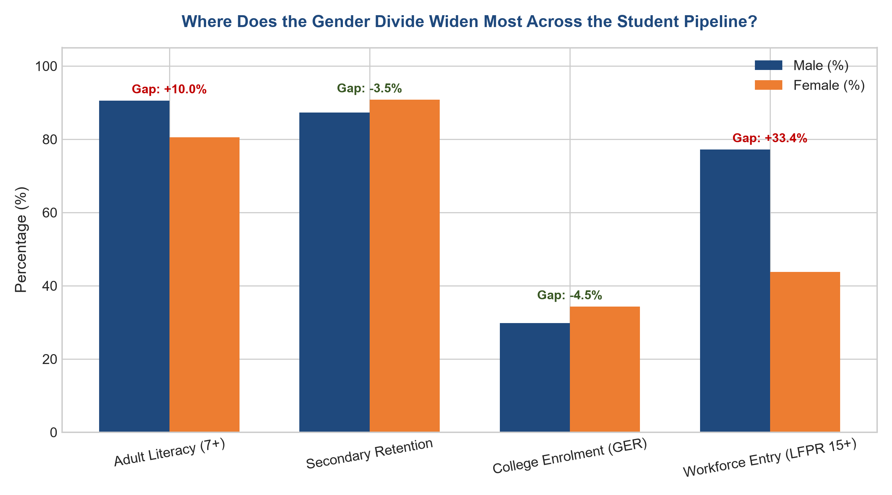
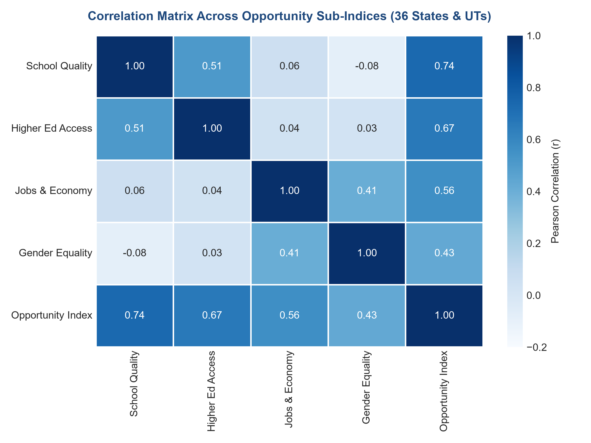
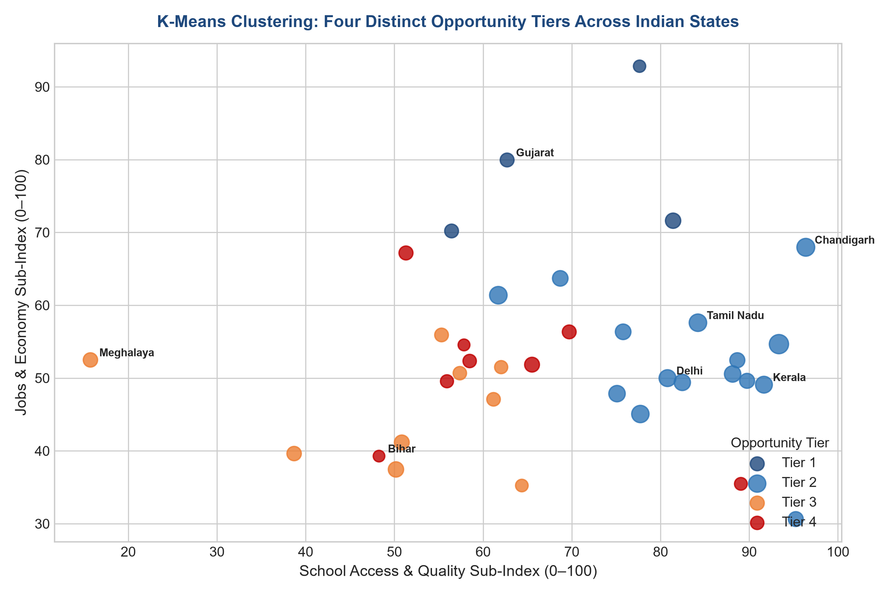

# The Opportunity Lottery
### Assessing Student Opportunity Disparities Across Indian States & Union Territories

[](https://www.python.org/)
[](LICENSE)
[]()
[]()
[](atlas/index.html)

**Analyst**: Pratyusha Das (B.Tech Computer Science, AI/ML Specialization, Finance Minor)  
**Repository**: [github.com/Pratyushadas0108/opportunity-lottery](https://github.com/Pratyushadas0108/opportunity-lottery)

---

## Executive Summary

How much does geography influence a student's educational trajectory and economic life chances in India? **The Opportunity Lottery** analyzes over 40 indicators across all 36 Indian States and Union Territories, synthesizing public datasets from UDISE+ (AY 2024–25), AISHE (AY 2023–24), PLFS (CY 2025), and Census 2011 into an interconnected student progression index.

```
       School Quality          Higher Education Access          Youth Jobs & Economy          Gender Equality
     (UDISE+ AY 2024-25)          (AISHE AY 2023-24)               (PLFS CY 2025)               (Cross-Pillar)
             │                          │                               │                            │
             └──────────────────────────┼───────────────────────────────┴────────────────────────────┘
                                        ▼
                   Composite Opportunity Index (0–100 Normalized Scale)
```

### Visual Highlights

| Top 5 vs. Bottom 5 Opportunity Divide | The Gender Progression Funnel |
| :---: | :---: |
|  |  |
| *A 25-point gap separates the top and bottom groups.* | *Parity in school reverses into a 39.1 pp gap at workforce entry.* |

| Progression Sub-Index Correlation Heatmap | Structural Opportunity Profiles (K-Means) |
| :---: | :---: |
|  |  |
| *School correlates with College ($r=0.51$), but College access shows no linear link with Jobs ($r=0.06$).* | *States segment into 4 descriptive structural groupings ($k=4$).* |

---

## 1. Key Empirical Findings

1. **A 25-point gap separates the top and bottom of the opportunity index**:  
   Across 36 states and UTs, the top five average `67.8` and the bottom five `42.5`. Among the 28 full states, Sikkim ranks first (`67.36`), Tamil Nadu is the highest-ranked large state (`64.92`), and Bihar is last at `35.52`. The ranking holds under three alternative weighting scenarios (four weighting schemes in total, Spearman $\rho \ge 0.90$).

2. **The gender gap appears at work, not in school**:  
   Girls drop out of secondary school less than boys (`9.6%` vs `13.3%`, UDISE+ AY 2024–25) and have a higher college enrolment ratio (`31.2%` vs `28.9%`, AISHE AY 2023–24). Yet male labour force participation is `79.1%` against `40.0%` for women, a `39.1` percentage point gap (PLFS CY 2025).

3. **Better school and college access go together, but neither lines up with youth job outcomes**:  
   School Quality and Higher Education Sub-Index scores are moderately correlated ($r = +0.512$), while Higher Education Access and Youth Jobs show almost no linear relationship ($r = +0.058$). Kerala ranks #2 on School Quality (`91.66`) and #7 on the Higher Education Sub-Index (`58.96`, raw GER: 41.2%), but drops to #26 on the Jobs Sub-Index (`49.09`, youth unemployment: 20.8%). Gujarat ranks #2 overall on the Jobs Sub-Index with `79.95` (lowest youth unemployment at `2.5%`), yet ranks #23 on the Higher Education Sub-Index (`40.02`, raw college GER: 26.3%).

4. **Two states can have the same score and need different help**:  
   Clusters 3 and 4 have nearly identical composite scores (`48.0` and `47.1`), but different shapes. Cluster 3 (mostly northeastern and hill states) is relatively strong on gender (`55.2`) and weak on schools (`50.6`). Cluster 4 (including Bihar, UP, and Rajasthan) has higher school scores (`62.0`) but the weakest higher education (`36.3`) and gender scores (`39.4`). Meghalaya shows the same pattern: a top-tier gender score (`64.82`, rank #3) alongside school electrification of only `28.1%` (rank #36).

5. **Higher literacy and urbanization do not guarantee higher female labour participation**:  
   Delhi is `97.5%` urban with female literacy of `84.4%`, yet it has the lowest female labour force participation in the country at `13.1%`. Among full states, Haryana (`23.8%`) and Bihar (`24.7%`) are lowest.

---

## 2. Actionable Policy Recommendations

Each intervention is calculated from a single explicit column sort in [clean_data/q6_targeted_interventions.csv](clean_data/q6_targeted_interventions.csv):

1. **Start school infrastructure funding in Meghalaya, Arunachal Pradesh, Bihar, Manipur, and Mizoram**:  
   They have the five lowest School Quality scores, and Meghalaya’s electrification figure (`28.1%`) shows basic facilities are the binding constraint. Check district-level data before allocating money, since state averages hide variation.

2. **Focus college capacity and faculty funding on Bihar and Jharkhand first**:  
   They have the lowest higher-education access scores among large states, with Bihar showing `61.3` students per teacher and `8.07` colleges per lakh population. Small UTs on the same list (Ladakh, Andaman & Nicobar, D&NH and D&D) probably need different solutions, such as scholarships to study elsewhere or online and distance options, because they cannot support many standalone colleges.

3. **Pair skilling programs for women with job-access support in Delhi, Haryana, Bihar, Lakshadweep, and Goa**:  
   Female literacy is already high in several of them, so the data suggests the barrier lies after education. Start with a pilot, track employment outcomes, and test local reasons before scaling.

---

## 3. Dual Rankings: All 36 Entities vs. 28 States Only

Because small Union Territories (Chandigarh, Puducherry, D&NH and D&D) are compact and highly urbanized, rankings are reported across both frameworks:

### Framework A: All 36 States & Union Territories
- **Top 5**: 1. Chandigarh (`70.05`), 2. Puducherry (`68.81`), 3. Dadra & Nagar Haveli and Daman & Diu (`67.95`), 4. Sikkim (`67.36`), 5. Tamil Nadu (`64.92`).
- **Bottom 5**: 32. Manipur (`45.70`), 33. Jammu & Kashmir (`45.58`), 34. Meghalaya (`43.97`), 35. Arunachal Pradesh (`41.74`), 36. Bihar (`35.52`).
- **Divide**: Top 5 average (`67.82`) is **1.60x higher** than Bottom 5 average (`42.50`) — a 25.32-point absolute gap.

### Framework B: 28 States Only (Excluding Union Territories)
- **Top 5 States**: 1. **Sikkim** (`67.36`), 2. **Tamil Nadu** (`64.92` — **#1 major state** pop > 10M), 3. **Kerala** (`63.94`), 4. **Himachal Pradesh** (`63.57`), 5. **Karnataka** (`59.86`).
- **Top 6–10**: 6. Goa (`59.04`), 7. Gujarat (`58.04`), 8. Uttarakhand (`57.83`), 9. Haryana (`57.59`), 10. Maharashtra (`57.38`).
- **Bottom 5 States**: 24. Jharkhand (`46.35`), 25. Manipur (`45.70`), 26. Meghalaya (`43.97`), 27. Arunachal Pradesh (`41.74`), 28. Bihar (`35.52`).

---

## 4. Data Sources, Provenance & Reference Periods

| Dataset | Issuing Body | Official Reference Period | Core Indicators Used |
| :--- | :--- | :---: | :--- |
| **UDISE+** | Dept of School Education & Literacy, MoE | **Academic Year 2024–25** | Secondary Transition, Secondary Dropout (by gender), PTR, % School Electricity, % Girls' Toilets, % Computers. |
| **AISHE** | Dept of Higher Education, MoE | **Academic Year 2023–24** | College GER (18–23 Total/Male/Female), Gender Parity Index, College Density, College PTR. |
| **PLFS** | National Sample Survey Office, MoSPI | **Calendar Year 2025** (Jan–Dec 2025) | Adult Literacy (7+), LFPR (15+), Youth Unemployment (15–29), Regular Salaried Share. |
| **Census** | Office of the Registrar General, MHA | **Census 2011** (1 March 2011) | Total Population, Male/Female Population, Urban Population Proportion (%). |

*Click-by-click download steps and reproduction instructions: [raw_data/README.md](raw_data/README.md).*

---

## 5. Methodological Limitations

1. **Association, Not Causation**: Observational macro aggregate data cannot establish causal mechanisms. Differences between states represent structural links and concurrent patterns rather than direct cause-and-effect.
2. **Untested Behavioral Hypotheses**: Explanations such as *"educated youth queueing for formal jobs"* and *"interstate graduate migration"* are recognized hypotheses in economic literature, but remain untested by this cross-sectional dataset.
3. **Descriptive Cluster Profiles**: The k-means clustering model ($k=4$) produced an average Silhouette Score of `0.271`. This indicates that states form a continuous gradient rather than sharply bounded, isolated classes. The clusters should be understood as descriptive structural groupings.
4. **Indicator Overlap / Double Counting**: The Gender Sub-Index incorporates female literacy alongside the literacy gender gap, and includes female LFPR (which conceptually touches workforce participation in the Jobs Sub-Index). Sensitivity runs confirm that rank correlations remain $\ge 0.901$ across alternative weightings.
5. **Temporal Asynchrony**: While education and labor indicators reflect modern 2023–2025 releases, demographic baselines rely on Census 2011 pending the publication of the Census 2021 release.
6. **Equal Weighting Choice**: Equal weights (25% per sub-index) represent a transparent baseline choice. Ranking robustness was validated through three alternative 40% priority models (Spearman $\rho \ge 0.901$).

---

## 6. Project Architecture & Reproduction

```text
omnamahashivaya/
├── raw_data/                  # Untracked official downloads (README.md download steps)
├── clean_data/
│   ├── state_master.csv       # 36 States/UTs x 40 reconciled indicators (0 nulls)
│   ├── opportunity_index.csv  # Min-Max normalized sub-indices & sensitivity runs
│   ├── state_clusters.csv     # K-Means k=4 structural profiles
│   └── q6_targeted_interventions.csv # Explicitly calculated candidate state lists
├── notebooks/
│   ├── 01_cleaning.ipynb      # PDF/Excel extraction & entity reconciliation
│   ├── 02_index_building.ipynb # Normalization, weighting & sensitivity
│   └── 03_analysis.ipynb      # Correlations, clustering, gap analysis
├── dashboard/
│   ├── Opportunity_Lottery.pbix # Completed Power BI Desktop file
│   ├── opportunity_powerbi_data.csv # Denormalized Power BI export
│   ├── powerbi_guide.md       # DAX measures & visual layout specs
│   └── charts/                # 6 presentation-ready charts
├── atlas/
│   └── index.html             # Standalone interactive Opportunity Atlas
├── docs/
│   ├── findings_table.md      # Complete empirical findings and insights
│   ├── data_dictionary.md     # Indicator definitions, directionality & formulas
│   ├── data_quality.md        # Audit verification & zero-null log
│   └── assumptions_log.md     # Audit trail of methodological decisions
└── LICENSE                    # MIT Code License & GoI Data Terms
```

### To Reproduce Locally
```bash
git clone https://github.com/Pratyushadas0108/opportunity-lottery.git
cd opportunity-lottery
python -m venv .venv
source .venv/bin/activate  # On Windows: .venv\Scripts\activate
pip install pandas numpy openpyxl scipy matplotlib seaborn pypdf pdfplumber
python scripts/run_analysis.py
python scripts/prepare_dashboard_data.py
python scripts/build_atlas.py
```

---

## 7. License & Data Terms

- **Code License**: Distributed under the **MIT License**. See [LICENSE](LICENSE) for details.
- **Data Terms**: All underlying raw datasets are public statistical releases of the Government of India, accessed under the provisions of the **National Data Sharing and Accessibility Policy (NDSAP)** for educational and non-commercial analytical purposes.
